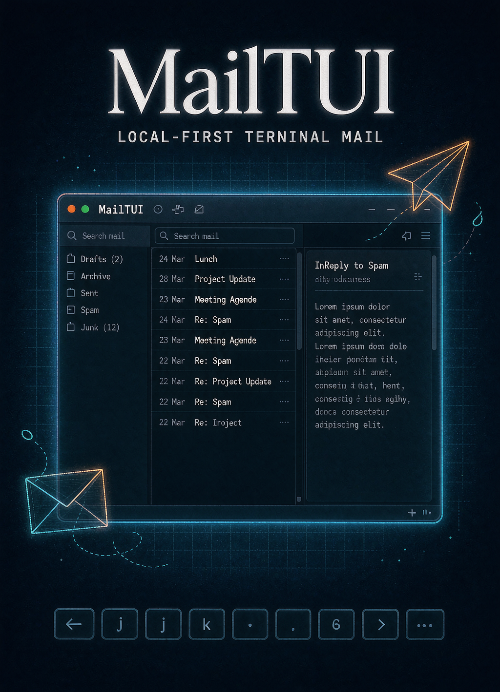

# MailTUI

<p align="center">
  
</p>

终端邮箱客户端。Python + Textual + SQLite，支持真实 IMAP 收信、SMTP 发信、HTML 正文纯文本抽取、搜索和基础邮件操作。

## 快速开始

```bash
uv sync
uv run mail account add
uv run mail --account work
```

`account add` 会依次询问账号、邮箱、IMAP/SMTP 地址和密码。密码优先保存到系统 keyring；keyring 不可用时，可以配置 `password_command` 或环境变量。

非交互式添加示例：

```bash
uv run mail account add \
  --key work \
  --email me@example.com \
  --username me@example.com \
  --display-name "Me" \
  --imap-host imap.example.com \
  --smtp-host smtp.example.com \
  --password-command "pass show mail/work"
```

## 密码来源

按优先级：

1. 环境变量 `MAILTUI_PASSWORD_<KEY>`，例如 `MAILTUI_PASSWORD_WORK`
2. `password_command` 的输出
3. 系统 keyring（service=`mailtui`，username=`<account key>`）
4. 启动时交互输入

推荐使用 keyring 或 `password_command`，不要把密码写进配置文件。

### WSL / 无桌面环境

如果 `mail doctor` 显示：

```text
keyring: keyring.backends.fail.Keyring
```

说明当前环境没有可用的 keyring 后端，密码无法持久化，因此每次启动都会提示输入。推荐配置 `password_command`，例如：

```toml
[[accounts]]
key = "work"
email = "me@example.com"
username = "me@example.com"
password_command = "pass show mail/work"

[accounts.imap]
host = "imap.example.com"
port = 993
security = "ssl"

[accounts.smtp]
host = "smtp.example.com"
port = 465
security = "ssl"
```

也可以使用 GPG 解密命令、1Password CLI、`secret-tool` 等外部命令。临时验证时可以用环境变量：

```bash
MAILTUI_PASSWORD_WORK='应用专用密码' uv run mail --account work
```

环境变量写在 shell 配置里属于明文存储，仅建议本机临时使用。

## 常用命令

```bash
uv run mail                     # 启动第一个账号
uv run mail --account work      # 启动指定账号
uv run mail --demo              # 内置演示数据
uv run mail account list        # 列出账号
uv run mail account remove work --purge-data
uv run mail doctor --stats      # 配置、数据库、文件夹统计
uv run mail doctor --check      # 测试 IMAP 登录
uv run mail db rebuild-fts      # 重建搜索索引
uv run mail db vacuum           # 压缩数据库
```

## 快捷键

启动时只展示“文件夹 + 邮件列表”两栏；按 `Enter` 或点击邮件后展开阅读区，`Esc` 收起阅读区回到列表。
阅读区右上角的 `×` 可以关闭阅读区；点击阅读区和邮件列表以外的区域也会自动关闭。

| 按键 | 动作 |
| --- | --- |
| `j` / `k` | 上下移动 |
| `Tab` | 在文件夹树和邮件列表间切换 |
| `←` / `→` | 收起/展开文件夹树节点 |
| `Enter` | 打开邮件并标记已读 |
| `c` | 撰写 |
| `a` | 账号管理（添加/删除） |
| `r` / `R` / `f` | 回复 / 回复全部 / 转发 |
| `s` | 星标 |
| `u` | 标记未读 |
| `d` | 移到回收站 |
| `o` | 打开附件保存面板（全部保存需确认） |
| `g` | 同步当前文件夹 |
| `/` | 搜索 |
| `?` / `F1` | 打开快捷键帮助 |
| `Esc` | 退出搜索/取消 |
| `q` | 退出 |

## 已实现

- 多账号配置、keyring/`password_command`/环境变量密码。
- TUI 内账号管理：`a` 打开账号列表，可添加、删除账号；新增/删除后重启生效。
- IMAP 文件夹发现与角色识别（Inbox/Sent/Drafts/Trash/Junk/Archive）。
- 文件夹树按 IMAP 分隔符自动构建级联菜单，支持展开/收起和未读数。
- SQLite 本地缓存：文件夹、邮件头、正文、附件、操作队列、FTS5 搜索。
- 启动同步和 60 秒轮询；正文按需抓取。
- HTML 邮件清洗后抽取纯文本，保留段落、列表、表格行、链接和图片 alt。
- 纯文本正文原样展示，不经过 Markdown 解释。
- 已读/未读、星标、移到回收站；操作进入持久化队列，失败自动退避重试。
- SMTP 发送、发送队列、发送成功后追加到 Sent。
- 附件改为可点击列表：单个附件弹窗查看/保存，`o` 打开显式的“全部保存”确认并显示目标目录。
- 图片附件在 Kitty/Sixel 等支持图片协议的终端内预览；不支持的终端保持普通附件列表。
- 图片类型会按文件内容嗅探，`application/octet-stream` 的 JPEG/PNG/WebP 附件也能识别并预览。
- 本地全文搜索（FTS5 trigram，短中文词回退 LIKE）。

## 当前限制

- 不做 HTML/CSS 富渲染，只展示抽取后的文本。
- 不支持 OAuth2，Gmail/Outlook 需要使用应用专用密码。
- 每个文件夹首次/每次同步只拉取最近 `initial_fetch` 封邮件，暂不支持无限回填。
- 不使用 IMAP IDLE，默认 60 秒轮询。
- 暂不支持草稿持久化，关闭撰写窗口后内容不会保留。
- 不支持 PGP/S/MIME、日历、联系人、规则引擎。
- 多账号配置可用，但一次只显示一个账号。

## 配置

配置文件位置：`~/.config/mailtui/config.toml`  
数据库：`~/.local/share/mailtui/mail.db`

参考 `config.example.toml`，也可以直接用 `mail account add` 生成。

## 测试

```bash
uv run pytest -q
```

设计文档见 `docs/DESIGN.md`，TUI 框架对比见 `poc/README.md`。
