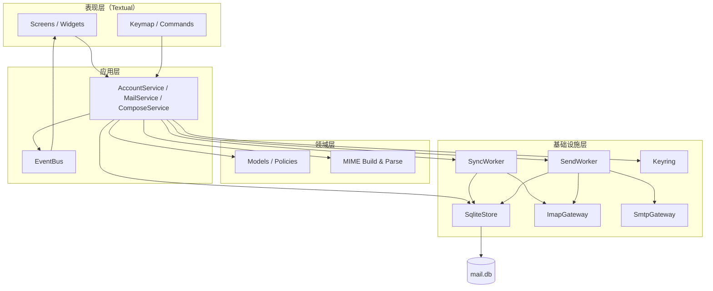
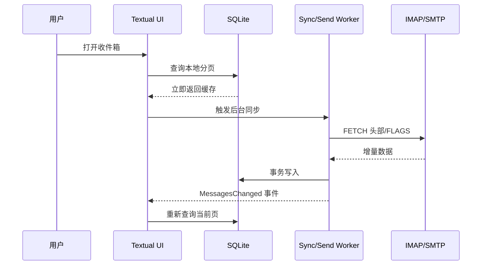
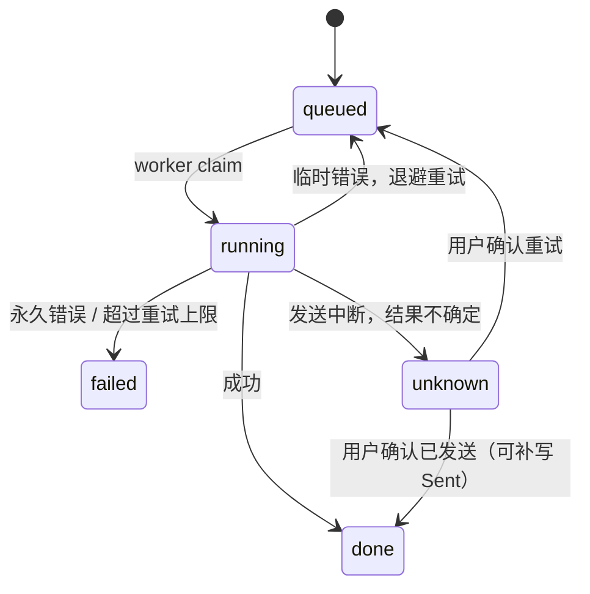

# 终端邮箱客户端设计文档

> 状态：Draft v1
> 输入：`docs/INTENT.md`
> 目标：在终端中完成邮箱的浏览、阅读、撰写与发送，本地使用 SQLite 缓存与索引

## 1. 背景与目标

### 1.1 一句话定义

一个本地优先（local-first）的 TUI 邮件客户端：通过 IMAP 同步邮件，通过 SMTP 发送邮件，SQLite 作为唯一的本地状态与缓存存储，用户无需离开终端即可完成日常邮件处理。

### 1.2 要解决的核心问题

1. **上下文切换成本高**：查收、回复邮件往往需要打开浏览器或桌面客户端。
2. **终端场景需要快速、键盘驱动**：列表浏览、搜索、回复应尽量少用鼠标。
3. **网络不稳定时体验差**：已读邮件、列表和正文应可离线访问，发送操作应可排队重试。
4. **状态一致性**：IMAP 的 UID/UIDVALIDITY、已读标记、删除、发送副本都需要被可靠地建模，避免“本地看起来成功、服务器其实没变”。

### 1.3 设计原则

- **本地优先**：UI 只读本地 SQLite，网络同步在后台进行；任何网络操作都不能阻塞界面。
- **命令化写操作**：所有会改变服务器状态的动作先落库为“操作”，再由后台 worker 执行，天然支持离线、重试与崩溃恢复。
- **复用成熟协议实现**：MIME 解析使用 Python 标准库 `email`，IMAP 使用 `imap-tools`，SMTP 使用 `aiosmtplib`，不自行实现协议细节。
- **奥卡姆剃刀**：单进程、单 SQLite、单事件循环、少量依赖；不引入 ORM、消息队列、微服务。
- **可替换边界**：邮件协议、界面、存储分别通过薄适配层隔离，未来可替换 UI 框架或接入 OAuth2。
- **安全默认**：强制 TLS、凭据进系统钥匙串、邮件内容防终端转义注入、附件不自动执行。

### 1.4 非目标（v1 明确不做）

- 不做完整 HTML/CSS 渲染；HTML 邮件仅抽取可读文本展示。
- 不支持 PGP/S/MIME 加解密与签名。
- 不支持 Exchange EWS/Graph、CalDAV、日历、联系人或规则引擎。
- 不支持 OAuth2 登录（架构预留，v1 使用密码/应用专用密码）。
- 不做多窗口、后台守护进程或 Web 界面。
- 不做本地数据库的跨设备同步（邮件本身仍由 IMAP 服务器同步）。

## 2. 需求分析

### 2.1 目标用户与典型场景

| 用户 | 场景 | 关键诉求 |
| --- | --- | --- |
| 终端开发者 | 编码间隙查收/回复邮件 | 快捷键、快速搜索、不打断工作流 |
| 运维/SRE | SSH 到服务器处理告警邮件 | 低依赖、可离线查看、纯文本友好 |
| 多账号用户 | 工作与个人邮箱切换 | 多账号配置、独立同步、统一收件箱视图（后续） |

### 2.2 功能需求

优先级：P0 = v1 必须；P1 = v1 尽量；P2 = 后续版本。

| ID | 需求 | 优先级 | 验收要点 |
| --- | --- | --- | --- |
| FR-01 | 多账号配置（IMAP/SMTP） | P0 | 配置文件 + `account add` 向导，密码存钥匙串 |
| FR-02 | 文件夹/标签列表 | P0 | 识别 INBOX、Sent、Drafts、Trash、Junk、Archive |
| FR-03 | 邮件列表 | P0 | 分页/窗口化加载，显示发件人、主题、时间、未读/星标/附件标记 |
| FR-04 | 阅读邮件 | P0 | 优先 `text/plain`；仅有 HTML 时清洗并抽取纯文本；正确解码 RFC 2047 头 |
| FR-05 | 附件 | P0 | 列表展示；按需下载到本地；不自动打开 |
| FR-06 | 已读/星标/删除/移动 | P0 | 本地立即生效，后台同步；离线可操作 |
| FR-07 | 撰写/回复/回复全部/转发 | P0 | 预填收件人与引用正文，支持草稿 |
| FR-08 | 发送 | P0 | SMTP 发送，失败重试，成功后保存到 Sent |
| FR-09 | 本地全文检索 | P0 | 主题、发件人、收件人、正文，FTS5，可离线 |
| FR-10 | 离线缓存 | P0 | 已同步的列表与正文在断网时仍可阅读 |
| FR-11 | 新邮件提醒 | P1 | IDLE/轮询后在状态栏与列表提示未读数 |
| FR-12 | 快捷键与帮助 | P0 | `?` 打开帮助，主要操作单键完成 |
| FR-13 | 草稿自动保存 | P1 | 编辑停顿 2 秒自动落库，异常退出可恢复 |
| FR-14 | 通讯录补全 | P2 | 基于历史收件人做 To/Cc 补全 |
| FR-15 | 服务器端搜索 | P2 | 本地未缓存邮件可通过 IMAP SEARCH 查询 |
| FR-16 | 多账号统一收件箱 | P2 | 聚合视图与账号颜色标识 |

### 2.3 非功能需求

| 类别 | 目标 |
| --- | --- |
| 启动性能 | 本地缓存 1 万封邮件时，冷启动到可交互 < 500 ms；网络同步不得阻塞启动 |
| 交互性能 | 列表翻页/光标移动 < 50 ms；单次操作反馈 < 100 ms |
| 资源占用 | 常驻内存 < 200 MB；SQLite 单文件；无后台常驻进程 |
| 可靠性 | 进程崩溃后不丢草稿/发件操作；不能静默重复发送 |
| 兼容性 | Linux/macOS 终端，80×24 可用；支持 256 色与真彩色，尊重 `NO_COLOR` |
| 可测试性 | 同步、发送状态机可在无真实网络的情况下单测 |
| 可维护性 | 核心业务不依赖 TUI 框架；数据库迁移可回滚/可重复执行 |

### 2.4 关键用户旅程

1. **首次使用**：`mail account add` → 输入邮箱/服务器/密码 → 测试 IMAP/SMTP → 同步最近 500 封 → 进入收件箱。
2. **日常查收**：启动 → 立即看到缓存列表 → 后台同步新邮件 → 打开未读邮件 → 自动标记已读。
3. **回复**：选中邮件 → `r` → 编辑正文 → `Ctrl+Enter` → 本地入队 → 发送成功 → Sent 中出现副本。
4. **断网**：列表和已缓存正文可读；已读/删除操作进入队列；恢复网络后自动执行。
5. **搜索**：`/` 输入关键词 → 本地 FTS 即时返回 → 回车打开。

## 3. 技术选型

### 3.1 选型结论

| 领域 | 选择 | 理由 | 被放弃的方案 |
| --- | --- | --- | --- |
| 语言/包管理 | Python 3.12 + `uv` | 要求明确；uv 管理依赖与运行环境快 | pip/poetry |
| TUI | **Textual** | 原生 async、组件化、CSS 布局、内置测试驱动 | prompt_toolkit（偏行编辑）、urwid（回调式、老化） |
| IMAP | **imap-tools**（同步库） | 封装 UID/搜索/文件夹/头部解析，减少协议细节 | 裸 `imaplib`；aioimaplib（生态与 IDLE 稳定性一般） |
| SMTP | **aiosmtplib** | async、支持 TLS/STARTTLS、与事件循环一致 | smtplib + 线程 |
| MIME | 标准库 `email` | 最成熟、无额外依赖，覆盖编码/多部分/附件 | 自研解析器 |
| HTML→纯文本 | **BeautifulSoup 清洗 + 自定义抽取** | 只保留可读正文，安全、稳定、依赖小 | 终端内嵌 HTML 浏览器（复杂且不安全）、Markdown 富渲染 |
| 配置 | TOML + `tomllib` + dataclass | 标准库解析、人可编辑、零额外依赖 | YAML/JSON/Pydantic Settings |
| 存储 | SQLite + 手写 SQL | 单文件、WAL、FTS5；模型简单无需 ORM | SQLAlchemy（抽象成本 > 收益） |
| 凭据 | **keyring** | 使用系统钥匙串；也可配置外部命令 | 明文配置文件 |
| 日志 | 标准库 `logging` + 文件轮转 | 简单、可控 | 结构化日志框架 |

### 3.1.1 TUI 框架 POC 结论

已用同一套三栏邮件界面验证四个候选，代码与运行方式见 `poc/README.md`：

| 框架 | 实测结论 |
| --- | --- |
| Textual | 组件最完整、async 与测试支持最好；默认观感偏方正，需要自定义 CSS 与列表行渲染来避免“呆板” |
| prompt_toolkit | 视觉控制力最强，可做逐字符渐变与高辨识度界面；列表、滚动、弹窗和表单需要自行搭建，代码量最大 |
| urwid | 成熟稳定、信息密度高，适合传统终端风格；palette/字符串边框的视觉上限较低 |
| pyTermGUI | 圆角窗口、主题和标记语言最容易做出“现代卡片”观感；生态与 API 稳定性最弱，长期维护风险最高 |

当前决策：**保留 Textual 作为默认方案**，因为同步、离线队列、弹窗和测试的工程量最低；如果观感仍不可接受，优先用 prompt_toolkit 做一版真实收件箱 A/B 原型，再决定是否替换。UI 层已被隔离，替换框架不影响存储、同步与发送设计。

### 3.2 为什么不用 mbsync/offlineimap

把 IMAP 同步交给 `mbsync`、应用只读 Maildir，可以显著降低同步实现难度，但会引入：

- 外部二进制依赖与平台安装问题；
- 已读/删除/移动操作的本地意图难以与 Maildir 状态精确对应；
- 附件、草稿、发送副本仍需额外协议实现；
- 与“SQLite 作为本地数据库”的目标不一致。

因此 v1 自建同步，但把 IMAP 封装在 `ImapGateway` 接口后，未来可增加 Maildir 后端而不影响 UI 与领域层。

### 3.3 依赖清单（预期）

```toml
[project]
name = "mailtui"
requires-python = ">=3.12"
dependencies = [
  "textual>=8.2",
  "imap-tools>=1.16",
  "aiosmtplib>=5.1",
  "keyring>=25.7",
  "beautifulsoup4>=4.12",
  "platformdirs>=4.0",
  "tomli-w>=1.2",
  "textual-image>=0.14",
]

[project.scripts]
mail = "mailtui.cli:main"
```

## 4. 总体架构

### 4.1 分层



约束：

- **表现层不直接访问 IMAP/SMTP**，只调用应用服务并消费事件。
- **领域层不依赖 Textual 与 imap-tools**，便于测试与替换。
- **SQLite 只由 `SqliteStore` 访问**，便于统一事务、迁移与并发控制。
- **文件夹使用 Textual `Tree` 展示**：按 IMAP delimiter 构建级联菜单，支持展开/收起、角色和未读数。

### 4.2 运行时进程模型

单进程、单 asyncio 事件循环，外加少量专用线程：

| 执行单元 | 数量 | 职责 | 说明 |
| --- | --- | --- | --- |
| Textual 事件循环 | 1 | UI 渲染、输入、事件分发 | 主线程 |
| `Store` 执行器 | 1 线程 | 串行执行所有 SQLite 操作 | 避免多连接写冲突，事务简单 |
| 每账号 IMAP 线程 | 每账号 1 | 执行 imap-tools 阻塞调用 | 连接有线程亲和性，不能跨线程复用 |
| `SendWorker` | 1 asyncio task | 处理发送队列 | SMTP 为 async，不占线程 |
| 事件总线 | 1 个队列 | Worker → UI 的领域事件 | UI 侧通过 Textual message 刷新 |

> 关键点：`imap-tools` 是同步 API，且 IMAP 连接不是线程安全的。每账号固定一个单线程执行器，保证同一连接的所有调用串行且发生在同一线程。

### 4.3 模块职责

| 模块 | 职责 |
| --- | --- |
| `config.py` | 加载/校验 TOML，解析账号与 UI 配置 |
| `domain/models.py` | Account、Folder、MessageSummary、Draft、Operation 等 DTO |
| `domain/mime.py` | 构建发送 MIME、解析头部/正文/附件、回复引用 |
| `db/store.py` | 迁移、事务、查询、FTS 索引维护 |
| `db/migrations/` | 编号 SQL 迁移脚本 |
| `services/sync.py` | 账号级同步循环、UID/UIDVALIDITY/FLAGS 处理、IDLE/轮询 |
| `services/send.py` | Outbox 状态机、SMTP 发送、Sent 追加、重试 |
| `services/search.py` | 本地 FTS 查询与结果排序 |
| `adapters/imap.py` | `ImapGateway` 的 imap-tools 实现 |
| `adapters/smtp.py` | `SmtpGateway` 的 aiosmtplib 实现 |
| `ui/app.py` | Textual App、屏幕路由、全局快捷键 |
| `ui/screens/` | 收件箱、阅读、撰写、账号、帮助、搜索 |
| `ui/widgets/` | 文件夹树、邮件列表、正文视图、状态栏 |

## 5. 核心设计

### 5.1 配置与账号

配置文件：`~/.config/mailtui/config.toml`（可用 `--config` 覆盖）。

**配置是账号信息的唯一事实来源**，SQLite 只保存运行期数据（以 `account_key` 关联），避免配置与数据库双写。

```toml
[ui]
theme = "textual-dark"
date_format = "%m-%d %H:%M"
page_size = 200
prefetch_bodies = 3

[sync]
poll_interval = 60          # 秒；IDLE 不可用时的轮询间隔
initial_fetch = 500         # 每个文件夹首次同步的邮件数
body_cache_days = 30        # 正文缓存保留天数

[[accounts]]
key = "work"                # 稳定标识，用于数据库与 keyring
email = "me@example.com"
display_name = "张三"
username = "me@example.com"
sent_copy = "append"        # append | none

[accounts.imap]
host = "imap.example.com"
port = 993
security = "ssl"            # ssl | starttls

[accounts.smtp]
host = "smtp.example.com"
port = 465
security = "ssl"

[[accounts]]
key = "personal"
email = "me@gmail.com"
display_name = "Me"
username = "me@gmail.com"
password_command = "pass show mail/gmail"   # 可选，优先级高于 keyring

[accounts.imap]
host = "imap.gmail.com"
port = 993
security = "ssl"

[accounts.smtp]
host = "smtp.gmail.com"
port = 465
security = "ssl"
```

凭据解析优先级：

1. `password_command` 的输出（兼容 `pass`、1Password CLI 等）；
2. 系统 keyring（service=`mailtui`，username=`account_key`）；
3. 交互式输入（仅当前会话使用）。

不提供明文密码配置项。无可用 keyring 后端（如部分无桌面环境的 Linux）时，提示用户改用 `password_command` 或每次启动输入。

启动时校验 `account_key` 全局唯一、IMAP/SMTP 主机与端口合法；账号配置错误只影响该账号，不阻止其他账号启动。

### 5.2 本地优先的数据流



所有查询都有本地结果；网络只负责“补齐”和“回写”。UI 永远不显示阻塞式加载页。

### 5.3 IMAP 同步

#### 5.3.1 同步单元

以 `(account_key, folder_id)` 为同步单元，每个账号串行同步其启用文件夹：

1. `SELECT` 文件夹，读取 `UIDVALIDITY`、`UIDNEXT`。
2. 若本地 `UIDVALIDITY` 为空或不一致：作废旧缓存，执行首次同步。
3. 首次同步：从最新一封向前抓取 `initial_fetch` 封头部。
4. 增量同步：`last_uid = MAX(message.uid)`，抓取 `last_uid + 1 : *` 的头部。
5. 标记同步：优先使用 `CONDSTORE`（`HIGHESTMODSEQ`）抓取变更；服务器不支持时，分批扫描已缓存 UID 的 FLAGS。
6. 删除检测：优先 `QRESYNC`/`VANISHED`；否则对比服务器 UID 集合，本地缺失者标记为已删除。
7. 新邮件监听：INBOX 上优先 IDLE；服务器或库不支持时退化为 `poll_interval` 轮询。

每账号维护一个串行命令队列，同步、FLAGS 更新、`APPEND` 都通过该队列执行，避免同一连接上并发命令。IDLE 必须带超时（建议 5 分钟），事件到达或超时后退出 IDLE，让出连接处理其他文件夹与操作队列。

#### 5.3.2 抓取字段

只抓头部，绝不抓整个 MIME：

```text
UID FETCH <uid> (UID FLAGS INTERNALDATE RFC822.SIZE
  BODY.PEEK[HEADER.FIELDS (DATE FROM TO CC SUBJECT MESSAGE-ID
  IN-REPLY-TO REFERENCES CONTENT-TYPE)])
```

使用 `BODY.PEEK` 避免同步时把邮件标记为已读。

正文在用户选中邮件时按需抓取：

```text
UID FETCH <uid> (BODY.PEEK[])
```

解析后只持久化：

- 纯文本正文；
- HTML 清洗并抽取后的纯文本；
- 附件元数据；
- 可选压缩后的原始 EML（用于“查看原文”，受缓存上限约束）。

#### 5.3.3 UIDVALIDITY 变更

`UIDVALIDITY` 变化意味着该文件夹所有 UID 失效：

1. 在单个事务中删除该文件夹的 `message`（级联删除 `body`/`attachment`，并显式删除对应的 FTS 行）；
2. 删除该文件夹下未完成的 `flag`/`move`/`delete` 操作，避免操作指向已失效 UID；保留草稿与 `send` 操作；
3. 重新执行首次同步；
4. UI 显示“文件夹已重建索引”提示，不弹阻塞对话框。

#### 5.3.4 文件夹角色识别

优先使用 IMAP `SPECIAL-USE` 标志：`\Inbox`、`\Sent`、`\Drafts`、`\Trash`、`\Junk`、`\Archive`。
否则按常见名称匹配（大小写不敏感）：`Sent`/`Sent Items`/`已发送`、`Trash`/`Deleted Items`/`已删除`、`Drafts`/`草稿`、`Junk`/`Spam`/`垃圾邮件`。
允许在配置中按账号覆盖角色映射。

### 5.4 邮件状态与操作队列

所有改变服务器状态的动作都写入 `operation` 表：

| kind | 语义 | 幂等性 |
| --- | --- | --- |
| `send` | 发送草稿（含可选追加 Sent） | 非幂等，需防重复 |
| `flag` | 设置/清除 `\Seen`、`\Flagged` | 幂等 |
| `move` | 移动到目标文件夹（如 Trash） | 近似幂等（目标已存在则视为成功） |
| `delete` | 永久删除（仅确认后） | 幂等 |

执行流程：



- **临时错误**：网络超时、连接重置、SMTP 4xx、IMAP 临时失败 → 指数退避（5s 起，上限 10 分钟，带抖动），最多 10 次。
- **永久错误**：认证失败、SMTP 5xx、收件人无效、附件超限 → `failed`，UI 展示具体原因。
- **结果不确定**：SMTP 在 `DATA` 阶段断连，服务器可能已接收。标记 `unknown`，**绝不自动重试**，提示用户“可能已发送，是否重试/标记已发送”。
- **崩溃恢复**：启动时把所有 `running` 操作改为：`send` → `unknown`；其他幂等操作 → `queued`；同时把遗留的 `body_state='fetching'` 重置为 `none`。
- **乐观更新**：UI 先更新本地状态并写入 operation；操作永久失败时重新同步该文件夹，以服务器状态为准并提示用户。
- **冲突规则**：某封邮件存在未完成的 `flag`/`move`/`delete` 操作时，后台同步不得用服务器旧状态覆盖其本地状态；操作完成后再以服务器回读结果为准。

### 5.5 撰写、回复与转发

#### 5.5.1 草稿模型

草稿保存结构化字段，而不是保存 MIME：

- 账号、类型（new/reply/reply_all/forward）；
- To/Cc/Bcc、Subject、正文纯文本；
- 附件（文件名、MIME、内容 BLOB）；
- 被回复/转发的原邮件 ID。

发送时才构建 MIME。这样编辑、自动保存、附件增删都更简单。

#### 5.5.2 回复规则

- `To`：原邮件 `Reply-To`，否则 `From`。
- `Cc`：原 `To` + `Cc`，排除当前账号地址与重复地址。
- `Subject`：已有 `Re:` 前缀则保留，否则添加。
- `In-Reply-To`：原 `Message-ID`。
- `References`：原 `References` + 原 `Message-ID`。
- 引用正文：纯文本 `> ` 前缀；HTML 先转纯文本，再生成 “On <date>, <sender> wrote:” 归属行。

#### 5.5.3 转发规则

- `Subject` 添加 `Fwd:`（已有则不重复）。
- 正文包含原邮件头部摘要与正文。
- v1 默认不自动携带原附件，提供“包含附件”开关。

#### 5.5.4 编辑体验

- 默认使用 Textual `TextArea` 内嵌编辑。
- `Ctrl+E` 导出为可编辑文本（头部 + 空行 + 正文），调用 `$EDITOR`/`$VISUAL`，保存后回读；附件单独保留。
- 停顿 2 秒自动保存草稿；`Esc` 关闭时若有未保存修改则确认。
- `queued`/`sent` 状态的草稿只读；需要修改时先“撤回为草稿”，避免发送快照与编辑内容不一致。

### 5.6 发送

#### 5.6.1 MIME 构建

使用 `email.message.EmailMessage` + `email.policy.SMTP`：

- 文本正文使用 UTF-8；
- 附件使用 `base64`；
- 正确编码非 ASCII 头部（RFC 2047）；
- 生成并持久化 `Message-ID`（`email.utils.make_msgid`）；
- `Bcc` 只进入 SMTP 信封，不写入邮件头；
- `Date`、`User-Agent` 自动生成。

发送前检查服务器 `SIZE` 扩展；超出限制直接给出错误，不进入无意义重试。

#### 5.6.2 发送流程

1. 用户在撰写页点击发送。
2. 事务内：序列化 MIME → 写入 `operation(mime_blob)` → 标记草稿为 `queued`。
3. `SendWorker` 认领操作，连接 SMTP（TLS/STARTTLS，校验证书，30 秒超时）。
4. 发送成功 → 若 `sent_copy=append`，通过该账号的 IMAP 命令队列执行 `APPEND` 写入 Sent（带 `\Seen`）；`sent_copy=none` 时只在本地保留已发送记录。
5. 操作标记 `done`，草稿标记 `sent`，清空 `mime_blob` 释放空间。
6. UI 收到 `OperationFinished` 事件，状态栏提示成功。

`APPEND` 失败不应把已成功的 SMTP 发送标记为失败：operation 记为成功并附带 `sent_copy_failed` 警告，提供“重试保存到 Sent”的入口。

#### 5.6.3 避免重复发送

- 发送前持久化 `Message-ID` 与 MIME；
- 只有 `queued` 操作会被自动认领；
- `running` → 崩溃恢复为 `unknown`，不自动重试；
- SMTP 明确的 4xx 才自动重试；网络中断导致的模糊状态交给用户确认。

这是 SMTP 本身缺少幂等键的现实约束，不能承诺 exactly-once。

### 5.7 阅读与渲染

Textual 没有原生 HTML 渲染器，也不是浏览器。HTML 邮件只做“正文可读”，不追求 HTML 保真。

处理优先级：

1. **`text/plain` 优先**：直接展示，保留原始换行。
2. **HTML 抽取纯文本**：
   - 用 BeautifulSoup（`html.parser`）解析；
   - 删除 `script`、`style`、`head`、`noscript`、`template`、`iframe`、`object`、`embed`、`svg`、`form`；
   - `<br>` 转换行；`p`/`div`/`section`/`article`/`h1`~`h6`/`blockquote`/`pre` 等块级标签前后加换行；
   - `<li>` 前加 `• `；`<tr>` 转换行，`<td>`/`<th>` 之间用制表符或两个空格分隔；
   - `` 替换为 `🖼 (alt)` 或 `[图片]`；
   - 链接保留锚文本；必要时在文本后追加 `(https://...)`，但不自动打开；
   - 折叠连续空格/空行，最终得到结构可读的纯文本。
3. **降级**：HTML 解析失败时，去掉标签后展示；仍失败则显示“正文解析失败，可查看原文”。
4. **渲染组件**：用 Textual `Static`/`Rich Text` 展示纯文本，不使用 `Markdown`，避免正文里的 `*`、`#`、`-` 被误解释为格式。
5. **图片**：HTML 远程图片默认不加载，只显示 `alt`；已下载的本地图片附件使用 `textual-image` 在 Kitty TGP/Sixel 终端内预览，不支持协议的终端保持普通附件列表。
6. **安全**：正文中的 ANSI 转义、控制字符在渲染前剥离；链接点击需确认，不自动打开。
7. **布局限制**：复杂 CSS、绝对定位、背景图、多列布局不会保留；表格内容会变成按行排列的文本。

> Textual 的 `Markdown` 组件仍可用于帮助页、README 或设置页，但不用于邮件正文。

正文使用 Textual 可滚动容器展示，默认软换行；`w` 切换换行。附件在正文下方列出：文件名、大小、MIME；`s` 保存，`o` 用系统默认程序打开（需确认）。“查看原文”以只读方式展示原始头部；原始 EML 仅在用户请求时抓取，不默认缓存全文。

### 5.8 搜索

使用 SQLite FTS5：

- 索引字段：主题、发件人、收件人、正文纯文本；
- `rowid = message.id`；
- 使用 FTS5 `trigram` 分词器，兼顾中文子串搜索与英文单词搜索（要求 SQLite ≥ 3.34）；少于 3 个字符的查询（常见于 2 字中文词）回退到当前文件夹/最近 N 封的 `LIKE` 查询，避免全表扫描，并提示可补充关键词；
- 应用层在同一事务中维护索引，不使用触发器（逻辑更直观，便于重建）；
- 默认搜索当前账号，可切换“全部账号/当前文件夹”；
- 结果按 `bm25` 排序，附带文件夹与日期；
- 提供 `mail db rebuild-fts` 命令用于全量重建。

服务器端搜索作为 P2：当本地结果不足时，可显式触发 IMAP `SEARCH`，仅拉取匹配头部。

### 5.9 事件总线

Worker 与 UI 之间只传递不可变事件：

| 事件 | 触发时机 | UI 响应 |
| --- | --- | --- |
| `SyncStateChanged` | 连接/同步状态变化 | 状态栏图标、错误提示 |
| `FoldersChanged` | 文件夹列表或未读数变化 | 刷新文件夹树 |
| `MessagesChanged` | 某文件夹新增/更新/删除 | 刷新当前列表（防抖） |
| `BodyReady` | 正文抓取完成 | 更新阅读页 |
| `OperationFinished` | 发送/标记/移动完成 | 通知并刷新 |
| `AuthRequired` | 认证失败 | 引导修改配置/重新输入密码 |

UI 消费事件时做 100–200 ms 防抖，避免同步大量邮件时频繁重绘。

## 6. 数据模型

### 6.1 存储位置与 PRAGMA

- 数据库：`~/.local/share/mailtui/mail.db`
- 日志：`~/.local/state/mailtui/`
- 缓存附件/导出：`~/.local/share/mailtui/files/`

```sql
PRAGMA journal_mode = WAL;
PRAGMA synchronous = NORMAL;
PRAGMA foreign_keys = ON;
PRAGMA busy_timeout = 5000;
PRAGMA user_version = 1;
```

迁移使用 `user_version` + 编号 SQL；每个迁移在事务中执行，失败即回滚。

### 6.2 核心表

```sql
CREATE TABLE folder (
  id            INTEGER PRIMARY KEY,
  account_key   TEXT    NOT NULL,
  name          TEXT    NOT NULL,              -- IMAP 路径
  delimiter     TEXT,
  role          TEXT,                          -- inbox/sent/drafts/trash/junk/archive
  uidvalidity   INTEGER,
  uidnext       INTEGER,
  highestmodseq INTEGER,
  last_sync_at  TEXT,
  sync_enabled  INTEGER NOT NULL DEFAULT 1,
  UNIQUE (account_key, name)
);

CREATE TABLE message (
  id              INTEGER PRIMARY KEY,
  account_key     TEXT    NOT NULL,
  folder_id       INTEGER NOT NULL REFERENCES folder(id) ON DELETE CASCADE,
  uid             INTEGER NOT NULL,
  message_id      TEXT,
  in_reply_to     TEXT,
  references_json TEXT,
  subject         TEXT    NOT NULL DEFAULT '',
  from_json       TEXT    NOT NULL DEFAULT '[]',  -- [{name,email}]
  to_json         TEXT    NOT NULL DEFAULT '[]',
  cc_json         TEXT    NOT NULL DEFAULT '[]',
  reply_to_json   TEXT    NOT NULL DEFAULT '[]',
  date_utc        TEXT    NOT NULL,               -- ISO-8601 UTC
  size            INTEGER,
  flags_json      TEXT    NOT NULL DEFAULT '[]',
  is_seen         INTEGER NOT NULL DEFAULT 0,
  is_flagged      INTEGER NOT NULL DEFAULT 0,
  is_deleted      INTEGER NOT NULL DEFAULT 0,
  has_attachments INTEGER NOT NULL DEFAULT 0,
  snippet         TEXT    NOT NULL DEFAULT '',
  body_state      TEXT    NOT NULL DEFAULT 'none'
                  CHECK (body_state IN ('none','fetching','ready','error')),
  created_at      TEXT    NOT NULL,
  UNIQUE (folder_id, uid)
);

CREATE INDEX idx_message_list
  ON message (folder_id, is_deleted, date_utc DESC, id DESC);
CREATE INDEX idx_message_unread
  ON message (folder_id, is_seen);
CREATE INDEX idx_message_account
  ON message (account_key, date_utc DESC);
CREATE INDEX idx_message_msgid
  ON message (account_key, message_id);

CREATE TABLE body (
  message_id INTEGER PRIMARY KEY REFERENCES message(id) ON DELETE CASCADE,
  text_body   TEXT,
  html_text     TEXT,        -- HTML 清洗后抽取的纯文本
  raw_eml     BLOB,          -- 可选，zlib 压缩
  fetched_at  TEXT NOT NULL
);

CREATE TABLE attachment (
  id           INTEGER PRIMARY KEY,
  message_id   INTEGER NOT NULL REFERENCES message(id) ON DELETE CASCADE,
  part_id      TEXT    NOT NULL,
  filename     TEXT,
  content_type TEXT,
  size         INTEGER,
  content_id   TEXT,
  local_path   TEXT,
  content      BLOB,
  state        TEXT    NOT NULL DEFAULT 'remote'
               CHECK (state IN ('remote','downloaded','missing')),
  UNIQUE (message_id, part_id)
);

CREATE TABLE draft (
  id                     INTEGER PRIMARY KEY,
  account_key            TEXT    NOT NULL,
  kind                   TEXT    NOT NULL
                         CHECK (kind IN ('new','reply','reply_all','forward')),
  reply_to_message_id    INTEGER REFERENCES message(id) ON DELETE SET NULL,
  to_json                TEXT    NOT NULL DEFAULT '[]',
  cc_json                TEXT    NOT NULL DEFAULT '[]',
  bcc_json               TEXT    NOT NULL DEFAULT '[]',
  subject                TEXT    NOT NULL DEFAULT '',
  body_text              TEXT    NOT NULL DEFAULT '',
  status                 TEXT    NOT NULL DEFAULT 'editing'
                         CHECK (status IN ('editing','queued','sent','failed')),
  created_at             TEXT    NOT NULL,
  updated_at             TEXT    NOT NULL
);

CREATE TABLE draft_attachment (
  id           INTEGER PRIMARY KEY,
  draft_id     INTEGER NOT NULL REFERENCES draft(id) ON DELETE CASCADE,
  filename     TEXT    NOT NULL,
  content_type TEXT    NOT NULL,
  size         INTEGER NOT NULL,
  content      BLOB    NOT NULL
);

CREATE TABLE operation (
  id              INTEGER PRIMARY KEY,
  account_key     TEXT    NOT NULL,
  kind            TEXT    NOT NULL
                  CHECK (kind IN ('send','flag','move','delete')),
  message_id      INTEGER REFERENCES message(id) ON DELETE SET NULL,
  draft_id        INTEGER REFERENCES draft(id) ON DELETE SET NULL,
  payload_json    TEXT    NOT NULL DEFAULT '{}',
  mime_blob       BLOB,
  status          TEXT    NOT NULL DEFAULT 'queued'
                  CHECK (status IN ('queued','running','done','failed','unknown')),
  attempts        INTEGER NOT NULL DEFAULT 0,
  next_attempt_at TEXT,
  last_error      TEXT,
  created_at      TEXT    NOT NULL,
  updated_at      TEXT    NOT NULL
);

CREATE INDEX idx_operation_claim
  ON operation (status, next_attempt_at, id);

CREATE TABLE settings (
  key   TEXT PRIMARY KEY,
  value TEXT NOT NULL
);

CREATE VIRTUAL TABLE message_fts USING fts5(
  subject,
  sender,
  recipients,
  body,
  tokenize = 'trigram'
);
```

### 6.3 建模说明

- **时间统一 UTC**：存储 ISO-8601 字符串，展示时转本地时区；`Date` 头缺失或非法时回退到 `INTERNALDATE`。
- **IMAP flags 双表示**：保留原始 `flags_json`，同时派生 `is_seen/is_flagged/is_deleted` 便于索引查询。
- **同一邮件出现在多个文件夹**：按“文件夹中的副本”分别存储（Gmail 标签会产生多行），通过 `message_id` 去重展示是 P2。
- **正文按需加载**：`body_state` 驱动 UI 状态与并发去重；同一封邮件正在抓取时不重复发请求。
- **草稿与发送操作分离**：草稿可反复编辑；发送时快照为 MIME 写入 operation，避免发送过程中继续编辑导致内容漂移。
- **附件内容**：MVP 为简化保存流程，把附件内容存入 `attachment.content`；后续可改为文件缓存并记录 `local_path`，避免数据库膨胀。

### 6.4 容量与清理

| 数据 | 策略 |
| --- | --- |
| 邮件头 | 长期保留；每账号每文件夹默认最近 500 封，滚动时向更早分页回填 |
| 正文 | 默认保留 30 天，按 LRU 删除；可配置 |
| 原始 EML | 仅在用户主动“查看原文”后临时缓存，最多 7 天 |
| 附件文件 | 保留至用户删除或缓存超限 |
| operation | `done` 记录保留 30 天，`failed/unknown` 保留至用户处理 |
| 发送 MIME | 成功后立即置空，避免数据库膨胀 |

## 7. 界面与交互

### 7.1 布局

```text
┌ 文件夹 ─────────┬ 邮件列表 ──────────────────────┬ 阅读 ────────────────┐
│ ▾ work          │ ● Alice     项目进度同步   10:24 │ From: Alice          │
│   Inbox      12 │   Bob       周会纪要       09:10 │ To: me               │
│   Sent          │   Carol     [附件] 合同    昨天  │ Subject: 项目进度同步 │
│   Drafts      2 │   Dave      告警恢复       昨天  │                      │
│ ▸ personal      │                                 │ 正文内容……           │
│                 │                                 │                      │
├─────────────────┴─────────────────────────────────┴──────────────────────┤
│ work | 已同步 10:25 | 未读 12 | ↑↓ 选择  Enter 阅读  c 撰写  / 搜索  ? 帮助 │
└──────────────────────────────────────────────────────────────────────────┘
```

- 启动时只显示文件夹树和邮件列表；按 `Enter`/点击邮件展开阅读窗格，`Esc` 收起。窄终端下阅读区占满剩余空间。
- 阅读区标题栏提供关闭按钮；点击阅读区和邮件列表以外的区域自动关闭阅读区。
- 宽度 < 70 列时隐藏文件夹窗格，通过 `Tab` 切换。
- 状态栏固定展示：当前账号、同步状态、未读数、错误/重试提示。

### 7.2 快捷键（Normal 模式）

| 按键 | 动作 |
| --- | --- |
| `j` / `k` / `↓` / `↑` | 移动光标 |
| `Enter` | 打开/关闭阅读 |
| `Tab` / `Shift+Tab` | 切换窗格 |
| `c` | 撰写新邮件 |
| `r` / `R` / `f` | 回复 / 回复全部 / 转发 |
| `s` | 星标切换 |
| `u` | 标记未读 |
| `w` | 切换正文软换行 |
| `d` / `D` | 移到回收站 / 永久删除（确认） |
| `/` | 搜索 |
| `g` | 同步当前文件夹 |
| `Ctrl+P` | 命令面板 |
| `?` | 帮助 |
| `q` | 返回/退出 |

### 7.3 撰写页

```text
From:    work <me@example.com>
To:      alice@example.com
Cc:      [隐藏]
Subject: Re: 项目进度同步
Attach:  report.pdf (2.1 MB)
────────────────────────────────────────────
On 2026-11-12, Alice wrote:
> 请确认本周进度……

好的，我今晚更新。
────────────────────────────────────────────
Ctrl+S 保存草稿   Ctrl+Enter 发送   Ctrl+E 外部编辑器   Esc 取消
```

状态提示：

- 草稿：`已保存 10:24` / `保存中…` / `保存失败`；
- 发送：`排队中` → `发送中` → `已发送` / `失败（点击查看原因）`；
- 离线：`离线，操作将在恢复网络后执行`。

### 7.4 空状态与错误态

| 场景 | 展示 |
| --- | --- |
| 首次无缓存 | 骨架 + “正在同步最近 500 封邮件” |
| 断网 | 保留列表 + 顶部黄色横幅“离线模式” |
| 认证失败 | 红色横幅 + “修改密码”操作，停止自动重试 |
| 文件夹为空 | “没有邮件” |
| 正文加载失败 | 正文区域显示原因 + 重试按钮 |
| 发送失败 | 状态栏红点 + 邮件详情页中的错误原因与重试入口 |

## 8. 错误处理与可观测性

### 8.1 错误分类

| 类型 | 示例 | 处理 |
| --- | --- | --- |
| `ConfigError` | 缺少账号、端口非法 | 启动时提示并退出到 CLI 帮助 |
| `AuthError` | IMAP/SMTP 认证失败 | 停止重试，引导重新认证 |
| `NetworkError` | DNS、超时、连接重置 | 退避重试，UI 显示离线 |
| `ProtocolError` | 无法解析响应、UID 异常 | 记录并跳过单封邮件，不中断文件夹同步 |
| `MessageParseError` | MIME 畸形 | 降级显示原始文本/占位，记录日志 |
| `PermanentSendError` | 5xx、收件人拒绝、超限 | 标记失败，不重试 |
| `AmbiguousSendError` | DATA 阶段断连 | 标记 unknown，需用户确认 |

### 8.2 日志

- 默认级别 `INFO`，`--debug` 提升到 `DEBUG`；
- 文件轮转：`~/.local/state/mailtui/mail.log`，单文件 10 MB，保留 5 个；
- **不记录正文、密码、完整收件人列表**；错误日志只记录 UID、文件夹、异常类型；
- 崩溃时记录堆栈，但不 dump 邮件内容；
- `mail doctor` 输出配置路径、数据库状态、迁移版本、账号连通性（隐藏敏感信息）。

### 8.3 诊断指标（本地可选）

不引入外部监控系统。`mail doctor --stats` 输出：

- 各文件夹邮件数、未读数、最后同步时间；
- 数据库大小、WAL 大小、FTS 行数；
- operation 各状态数量；
- 最近 24 小时错误计数。

## 9. 安全设计

1. **传输安全**：IMAP/SMTP 仅允许 `ssl` 或 `starttls`，默认校验证书；不提供“忽略证书”开关。
2. **凭据安全**：密码只存系统 keyring 或由外部命令提供；内存中不长期保留；日志脱敏。
3. **终端注入防护**：邮件正文/主题/附件文件名中的 ANSI 转义、`\r`、其他控制字符在渲染前剥离。
4. **HTML 安全**：HTML 仅离线清洗并抽取文本；不加载远程资源；不渲染脚本。
5. **附件安全**：不自动执行/打开；保存时清洗文件名，禁止路径穿越；可执行文件类型额外确认。
6. **数据库权限**：数据目录 `0700`，数据库文件 `0600`。
7. **发送确认**：默认 `Ctrl+Enter` 发送；收件人为空或附件超限时阻止；外部编辑器返回后若收件人变化需重新确认。
8. **Bcc 保护**：Bcc 不写入邮件头，只用于 SMTP 信封。

## 10. 工程结构

```text
mail/
├── pyproject.toml
├── uv.lock
├── README.md
├── docs/
│   ├── INTENT.md
│   └── DESIGN.md
├── src/mailtui/
│   ├── __main__.py
│   ├── cli.py
│   ├── config.py
│   ├── paths.py
│   ├── logging.py
│   ├── domain/
│   │   ├── models.py
│   │   ├── mime.py
│   │   └── errors.py
│   ├── db/
│   │   ├── store.py
│   │   ├── search.py
│   │   └── migrations/
│   │       └── 0001_init.sql
│   ├── services/
│   │   ├── accounts.py
│   │   ├── mail.py
│   │   ├── compose.py
│   │   ├── sync.py
│   │   ├── send.py
│   │   └── events.py
│   ├── adapters/
│   │   ├── imap.py
│   │   ├── smtp.py
│   │   ├── keyring.py
│   │   └── editor.py
│   └── ui/
│       ├── app.py
│       ├── keymap.py
│       ├── screens/
│       │   ├── mailbox.py
│       │   ├── reader.py
│       │   ├── composer.py
│       │   ├── search.py
│       │   └── help.py
│       └── widgets/
│           ├── folder_tree.py
│           ├── message_list.py
│           ├── message_view.py
│           └── status_bar.py
└── tests/
    ├── unit/
    │   ├── test_mime.py
    │   ├── test_sync_state.py
    │   ├── test_outbox.py
    │   └── test_store.py
    ├── ui/
    │   └── test_smoke.py
    └── integration/
        └── test_imap_smtp.py
```

### 10.1 CLI

```text
mail                         启动 TUI
mail --account work          指定默认账号
mail --config PATH           指定配置文件
mail account add             交互式添加账号
mail account list            列出账号
mail account remove KEY      删除账号（默认保留数据）
mail account remove KEY --purge-data
mail db migrate              执行迁移
mail db rebuild-fts          重建全文索引
mail db vacuum               压缩数据库
mail doctor [--stats]        诊断环境与账号连通性
```

`account remove` 同时删除 keyring 中的凭据；`--purge-data` 额外删除该账号的文件夹、邮件、正文、附件缓存与草稿。

### 10.2 启动顺序

1. 解析 CLI 与配置；
2. 初始化日志与数据目录；
3. 获取单实例文件锁，避免两个进程同时写同一个数据库；
4. 打开 SQLite、执行迁移；
5. 构造 Store、Adapters、Services；
6. 启动 Textual App，立即渲染缓存；
7. 启动 SyncWorker / SendWorker；
8. 同步当前选中文件夹与 INBOX；
9. 恢复上次选中的文件夹与光标位置。

## 11. 测试策略

### 11.1 单元测试

- **MIME**：RFC 2047 编码头、UTF-8 正文、`multipart/alternative`、嵌套 multipart、内联图片、附件、畸形 MIME、超长头部。
- **同步状态**：首次同步、增量 UID、UIDVALIDITY 变更、FLAGS 变更、服务器端删除、连接中断后续传。
- **操作队列**：SMTP 4xx 重试、5xx 失败、DATA 断连转 unknown、进程崩溃恢复、退避时间计算。
- **数据库**：迁移幂等、级联删除、FTS 更新/删除、分页稳定性。
- **回复/转发**：收件人计算、去重、`References` 链、主题前缀。

### 11.2 适配器测试

定义协议接口：

```python
class ImapGateway(Protocol):
    def list_folders(self) -> list[FolderInfo]: ...
    def select(self, folder: str) -> FolderStatus: ...
    def fetch_headers(self, folder: str, uids: Sequence[int]) -> list[HeaderData]: ...
    def fetch_raw(self, folder: str, uid: int) -> bytes: ...
    def set_flags(self, folder: str, uid: int, add: set[str], remove: set[str]) -> None: ...
    def append(self, folder: str, raw: bytes, flags: set[str]) -> None: ...
```

测试中使用 `FakeImapGateway` / `FakeSmtpGateway` 模拟服务器行为，不依赖网络。
可选的集成测试通过 Docker 启动 GreenMail 或 Dovecot，默认不在 CI 中运行。

### 11.3 UI 测试

- 使用 Textual `run_test()` 做冒烟测试：启动、打开邮件、切换文件夹、打开撰写页、发送确认。
- 不追求像素级快照，只验证关键文本与焦点行为。

### 11.4 手工验收清单

- [ ] Gmail / Outlook / 自建 Dovecot 至少各验证一次。
- [ ] 断网后浏览已缓存邮件、恢复网络后队列自动执行。
- [ ] 大附件、无附件、纯 HTML、纯文本、中文编码邮件。
- [ ] 80×24 与 200×50 两种终端尺寸。
- [ ] 发送过程中杀掉进程，重启后状态为 `unknown` 且不会自动重发。

## 12. 性能与容量设计

| 关注点 | 措施 |
| --- | --- |
| 启动速度 | UI 先渲染缓存；同步异步；数据库只建必要索引 |
| 列表滚动 | 分页查询（默认 200 条），滚动接近底部再取下一页；避免一次性加载全部 |
| 同步吞吐 | 头部批量 FETCH；事务批量写入；每批 100–200 条 |
| UI 刷新 | 事件防抖 100–200 ms；只刷新受影响文件夹 |
| 正文抓取 | 按需 + 预取当前选中前后 3 封；`body_state` 去重 |
| 数据库体积 | 头部长期、正文 LRU、原始 EML 临时；定期 `VACUUM` |
| FTS 体积 | 只索引纯文本正文，不索引附件；可重建 |

容量估算：1 万封头部约 10–20 MB；1 千封正文约 5–20 MB；FTS 约为正文的 30%–60%。

## 13. 里程碑

### M0：工程骨架（0.5 天）

- `uv init`、pyproject、入口 `mail`；
- 配置加载、路径管理、日志；
- SQLite 打开与迁移框架；
- Textual 空壳 + 状态栏。

**验收**：`uv run mail` 可启动/退出；`mail doctor` 可用。

### M1：只读收件箱（2–3 天）

- 账号配置与 keyring；
- IMAP 连接、文件夹列表、首次/增量头部同步；
- 三栏布局、邮件列表、纯文本正文与 HTML→纯文本抽取、附件列表与保存；
- 基本快捷键。

**验收**：可浏览最近 500 封邮件并打开正文，重启后无需重新拉取头部。

### M2：邮件操作与搜索（2 天）

- 已读/星标/删除/移动；
- operation 队列与后台执行；
- FTS5 搜索、分页回填更早邮件；
- 错误横幅与离线状态。

**验收**：离线执行已读/删除，恢复网络后服务器状态一致。

### M3：撰写与发送（2–3 天）

- 撰写/回复/回复全部/转发；
- 草稿自动保存与恢复；
- SMTP 发送、Sent 追加、失败重试、unknown 状态处理；
- 附件添加/保存。

**验收**：完成“收到邮件 → 回复 → 对方收到 → Sent 有副本”的闭环。

### M4：健壮性与发布（2 天）

- IDLE/轮询、CONDSTORE/QRESYNC 探测与退化；
- 崩溃恢复、日志脱敏、`mail doctor --stats`；
- 单元/UI 测试补齐；
- README、安装说明、示例配置。

**验收**：在真实网络抖动与进程重启场景下不丢草稿、不重复发送。

## 14. 风险与对策

| 风险 | 影响 | 对策 |
| --- | --- | --- |
| 各家 IMAP 实现差异大 | 同步失败/标记不一致 | 适配层隔离；真实服务器验收；对特殊能力做探测与退化 |
| Textual 大数据列表性能 | 滚动卡顿 | 分页 + 只渲染视口附近；压力测试 1 万封 |
| HTML 邮件抽取效果差 | 可读性下降 | 明确产品预期；提供“查看原文”；后续可增加块级标签/表格/图片占位优化 |
| SMTP 结果不确定 | 重复发送 | `unknown` 状态 + 用户确认，绝不自动重试 |
| 证书/企业代理问题 | 无法连接 | 使用系统信任库；清晰错误提示；不支持关闭校验 |
| 密码/应用专用密码限制 | Gmail 等无法登录 | v1 文档说明使用 app password；预留 OAuth2 提供方接口 |
| 数据库被多进程同时打开 | 锁竞争/损坏 | 单实例锁文件；WAL + busy_timeout；发现第二个实例时提示退出 |
| 邮件内容触发终端漏洞 | 安全风险 | 剥离 ANSI/控制字符；不渲染 HTML/脚本 |

## 15. 开放问题

以下问题不阻塞 v1 实现，但会影响优先级：

1. **首要邮箱提供商**：若 Gmail/Outlook 是主要目标，OAuth2 可能应提前到 M1，而不是 v1 之后。
2. **是否需要服务端草稿同步**：v1 草稿仅本地保存；是否要求换机器后可见？
3. **附件策略**：只支持“保存到磁盘”，还是需要“用系统程序打开”？
4. **多账号呈现**：v1 是账号切换，还是必须首版就提供统一收件箱？
5. **是否接受外部编辑器作为主撰写方式**：当前设计为内嵌编辑 + 外部编辑器逃生口。
6. **HTML 邮件的阅读期望**：纯文本抽取是否足够，还是需要更强的表格/列布局保真？

## 16. 决策摘要

| 决策 | 结论 |
| --- | --- |
| 架构 | 单进程、分层、本地优先 |
| UI | Textual，三栏 + 全屏阅读 |
| 同步 | 每账号单连接、单线程执行器；头部增量同步、正文按需 |
| 写操作 | 统一 operation 队列，后台执行、可重试、可恢复 |
| 数据 | SQLite WAL + FTS5；配置为账号唯一事实来源 |
| 发送 | 草稿结构化存储，发送时快照 MIME；SMTP 后追加 Sent |
| 安全 | TLS 强制、keyring、终端转义清洗、附件不自动执行 |
| 测试 | 协议适配层可替换，核心状态机无网络单测 |
| 演进 | OAuth2、多账号聚合、服务端搜索、Maildir 后端均可在现有边界内扩展 |

## 17. 当前实现状态（MVP）

已落地：

- Textual 三栏界面、实时账号启动、后台同步与状态栏。
- 底部快捷键提示栏，`?` / `F1` 打开分组快捷键帮助页。
- TOML 账号配置、`keyring`/`password_command`/环境变量密码、账号增删查。
- TUI 账号管理界面：`a` 打开账号列表，添加/删除账号。
- SQLite 建库迁移、文件夹/邮件/正文/附件/操作队列、FTS5 搜索。
- IMAP 文件夹发现、最近 N 封邮件头同步、正文按需抓取、已读/星标/移动。
- HTML 正文清洗为纯文本、可点击附件列表、显式保存确认与图片附件预览。
- SMTP 发送、发送队列、指数退避、Sent 追加。
- `mail --demo`、`mail doctor`、`mail db rebuild-fts/vacuum`。

仍待补齐：

- OAuth2、IMAP IDLE、无限历史回填、服务端草稿同步。
- operation `unknown` 状态的用户确认/重试界面。
- 多账号统一收件箱、附件打开、PGP/S/MIME。
- 更完整的 IMAP 能力探测（CONDSTORE/QRESYNC）和服务器端搜索。
